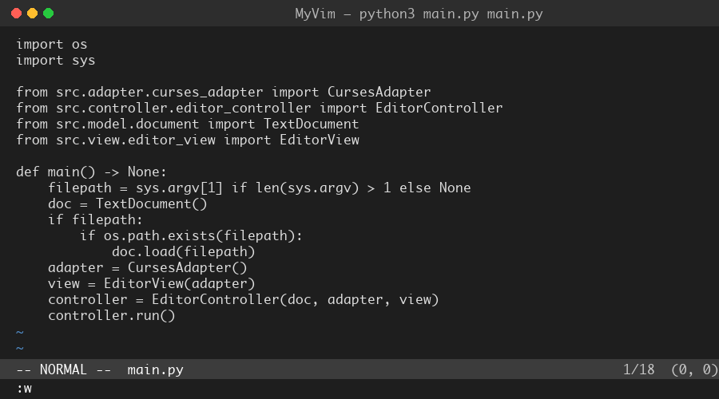

# MyVim — Консольный текстовый редактор и TUI MVC-фреймворк

**MyVim** — это терминальный текстовый редактор с VIM-подобным модальным управлением, написанный на Python 3 с использованием C++ ядра для хранения строк (`MyString`, `pybind11`).

Проект реализует архитектуру **MVC** с поддержкой нескольких представлений (**Multi-View**), принципы **SOLID** и паттерны проектирования **Adapter**, **Decorator**, **Command**, **Singleton** и **Builder**, а также включает независимый MVC-фреймворк (`src/framework/`) и демонстрационное приложение мониторинга процессов (`demo_app.py`).

---

## Основные возможности

* Модальная модель управления VIM: `NORMAL`, `INSERT`, `COMMAND`, `SEARCH`.
* Область текста с символами `~` для пустых строк ниже конца файла и горизонтальной/вертикальной прокруткой.
* Отключаемая динамическая нумерация строк (`:set num`, `:set nonu`, `:set num!`).
* Подсветка синтаксиса для Python и C++ (`:sy`, `:sy on`, `:sy off`) с поддержкой 256-цветовой палитры (и fallback на базовые цвета/атрибуты терминала).
* Раздельная статус-строка (`EditorStatusView`) с отображением текущего режима (`-- NORMAL --`), имени файла (или `[No Name]`), флага несохранённых изменений `[+]`, индикатора `[syntax]` и позиции `строка/всего_строк`, а также нижняя строка команд и сообщений.
* Независимый TUI MVC-фреймворк (`src/framework/`) и вторая демонстрационная программа `demo_app.py` (System Activity Monitor).



---

## Структура проекта

```text
.
├── main.py                         # Точка входа редактора (EditorApplication)
├── demo_app.py                     # Демонстрационное TUI-приложение (System Activity Monitor)
├── mystring/                       # C++ ядро MyString и биндинг pybind11
├── src/
│   ├── adapter/                    # ITuiAdapter, KeyCode, CursesAdapter, MockTuiAdapter
│   ├── model/                      # TextDocument, TextLine, WordNavigator, CommandHistory (SingletonMeta)
│   ├── view/                       # IEditorView, EditorView, EditorStatusView, SyntaxHighlightDecorator
│   ├── controller/                 # EditorController, CommandRegistry, ICommand и классы команд
│   └── framework/                  # ITui*, TuiApplication, ApplicationBuilder, ApplicationDirector
└── tests/                          # 60 модульных и интеграционных тестов pytest
```

---

## Архитектура и паттерны проектирования


### 1. MVC и Multi-View
* **Model (`TextDocument`)**: хранит список строк `TextLine`, координаты курсора с запоминанием целевой колонки (`_desired_col`), буфер обмена, историю снимков `CommandHistory`, поддерживает поиск по тексту и работу с файлами (`load` / `save`).
* **View (`EditorView`, `EditorStatusView`)**: реализуют разделение отображения текста (`EditorView`, `include_status=False`) и строки состояния/командной строки (`EditorStatusView`). Взаимодействуют с экраном через `ITuiAdapter`.
* **Controller (`EditorController`)**: реализует конечный автомат режимов (`EditorMode`: `NORMAL`, `INSERT`, `COMMAND`, `SEARCH`), обрабатывает клавиши, буферизует многосимвольные и числовые последовательности (`dd`, `diw`, `gg`, `10G`), управляет списком представлений (`add_view`, `get_views`) и декорированием основного View.
* **Точка входа (`EditorApplication`)**: связывает модель, адаптер, оба представления и контроллер через `ApplicationBuilder`.

### 2. Паттерн «Адаптер» (`src/adapter/`)
Абстрактный интерфейс `ITuiAdapter` и перечисление `KeyCode` изолируют приложение от библиотеки `curses`:
* **`CursesAdapter`**: реализация для терминалов macOS/Linux с `set_escdelay(25)` и инициализацией 256-цветовых пар.
* **`MockTuiAdapter`**: эмулятор экрана и очереди клавиш в памяти для headless-тестирования без TTY.

### 3. Паттерн «Декоратор» (`src/model/text_line.py`, `src/view/syntax_decorator.py`)
Паттерн применён на двух уровнях:
* **Model (`TextLine`)**: оборачивает C++ класс `MyString`, переводит символьные индексы в UTF-8 байтовые смещения и делегирует навигацию по словам классу `WordNavigator`.
* **View (`SyntaxHighlightDecorator`)**: наследует `EditorViewDecorator(IEditorView)` и динамически оборачивает `EditorView` при вызове `EditorController.toggle_syntax_highlighting(...)`, выполняя лексический разбор текста (`_TOKEN_REGEX`) и цветовую подсветку без изменения кода базового представления.

### 4. Паттерн «Команда» (`src/controller/commands.py`)
Операции редактора инкапсулированы в 39 конкретных классов команд, реализующих `ICommand.execute(...)`:
* Режим команд: `SetLineNumbersCommand`, `SyntaxCommand`, `SaveCommand`, `SaveAndQuitCommand`, `OpenFileCommand`, `RevertCommand`, `QuitCommand`, `GotoLineCommand`, `HelpCommand`.
* Режим навигации и редактирования: `UndoCommand`, `UndoLineCommand`, `DeleteCharCommand`, `CutLineCommand`, `DeleteWordCommand`, `CopyLineCommand`, `CopyWordCommand`, `PasteCommand`, `Cursor*Command`, `ChangeModeCommand`, `EnterReplaceModeCommand`, `NormalQuitCommand`, `EscCommand`, а также `InsertTextCommand`, `SplitLineCommand`, `BackspaceCommand`, `RepeatSearchCommand`, `SearchCommand`, `ReplaceCharCommand`.
* **`CommandRegistry`**: хранит точные и префиксные команды режима `COMMAND`, числовой обработчик (`:<N>`), а также таблицы клавиш `NORMAL` (`register_normal_key`, `register_multi_key`) и `INSERT` (`register_insert_key`).

### 5. Паттерн «Одиночка» (`src/model/command_history.py`)
* **`CommandHistory`** с метаклассом **`SingletonMeta`**: единый экземпляр стека снимков состояния документа (`capacity = 100`) для выполнения `u` (`undo`), `U` (`undo_line`) и сброса стека при `:e!` (`revert`).

### 6. Паттерн «Строитель» и MVC-фреймворк (`src/framework/`)
Пакет `src/framework/` не зависит от кода текстового редактора:
* **Контракты (`src/framework/base.py`)**: `ITuiModel`, `ITuiView`, `ITuiController`, `ITuiApplication`.
* **Продукт (`TuiApplication`)**: хранит адаптер, модель, список представлений (`_views`, `add_view`, `get_views`, `render_views`) и запускает цикл обработки событий `run()`.
* **Строитель и распорядитель (`ApplicationBuilder`, `ApplicationDirector`)**: пошаговая настройка и валидация компонентов (`set_adapter`, `set_model`, `set_view`, `add_view`, `set_views`, `set_controller`, `reset`, `build`, `construct`).

---

## Поддерживаемые команды MyVim

### 1. Режим навигации и редактирования (NORMAL)
Режим по умолчанию при запуске.

| Клавиша | Действие |
| :--- | :--- |
| `h`, `j`, `k`, `l` (или стрелки) | Перемещение курсора влево, вниз, вверх, вправо |
| `0`, `^`, `Home` | Переход в начало текущей строки |
| `$`, `End` | Переход в конец текущей строки |
| `w` | Переход к концу текущего или следующего слова |
| `b` | Переход к началу текущего или предыдущего слова |
| `gg` | Переход в начало документа (строка 1) |
| `G` | Переход в конец документа |
| `<число>G` (например `10G`) | Переход на указанную строку документа |
| `PageUp` / `PageDown` | Постраничная прокрутка текста |
| `x` / `Delete` | Удаление символа под курсором с сохранением в буфер |
| `r<символ>` | Замена символа под курсором |
| `dd` | Вырезание текущей строки в буфер обмена |
| `dw` / `diw` | Удаление слова под курсором |
| `yy` | Копирование текущей строки в буфер обмена |
| `yw` | Копирование слова под курсором в буфер обмена |
| `p` | Вставка из буфера обмена после курсора / строки |
| `u` | Отмена последнего изменения |
| `U` | Отмена изменений в текущей строке |
| `n` / `N` | Повтор поиска вперёд / назад |
| `q` | Быстрый выход (если документ не изменён) |
| `ESC` (дважды) | Быстрый выход из редактора |
| `Ctrl+C` / `Ctrl+D` | Корректное завершение программы |

### 2. Режим ввода текста (INSERT)

| Клавиша | Действие |
| :--- | :--- |
| `i` | Ввод текста перед курсором |
| `I` | Переход в начало строки и ввод текста |
| `A` | Переход в конец строки и ввод текста |
| `o` | Открытие новой строки снизу и ввод текста |
| `O` | Открытие новой строки сверху и ввод текста |
| `S` | Очистка текущей строки и ввод текста |
| `ESC` | Возврат в режим `NORMAL` |

### 3. Режим командной строки (COMMAND)
Активируется клавишей `:` в режиме `NORMAL`. Поддерживаются русские алиасы раскладки.

| Команда | Русские алиасы | Действие |
| :--- | :--- | :--- |
| `:w` | `:ц` | Сохранить текущий файл |
| `:w <filename>` | `:ц <filename>` | Сохранить документ в указанный файл |
| `:o <filename>` / `:e <filename>` | `:щ <filename>` / `:у <filename>` | Открыть файл с диска |
| `:q` / `:quit` | `:й` | Выйти (с проверкой несохранённых изменений) |
| `:q!` / `:quit!` | `:й!` | Выйти без сохранения |
| `:wq` / `:wq!` / `:x` / `:x!` | `:цй` / `:цй!` / `:ч` / `:ч!` | Сохранить текущий файл и выйти |
| `:e!` | `:у!` | Отменить все несохранённые изменения (откат к файлу на диске) |
| `:<число>` | — | Переход на указанную строку |
| `:set num` / `:set nu` | — | Включить нумерацию строк |
| `:set nonu` / `:set nonumber` | — | Отключить нумерацию строк |
| `:set num!` / `:set nu!` / `:set invnu` | — | Переключить нумерацию строк |
| `:sy` / `:syntax` / `:sy!` | `:сы` / `:сы!` | Переключить подсветку синтаксиса |
| `:sy on` / `:syntax on` | `:сы on` | Включить подсветку синтаксиса |
| `:sy off` / `:syntax off` | `:сы off` | Отключить подсветку синтаксиса |
| `:h` / `:help` | — | Показать краткую справку в статус-строке |
| `ESC` | — | Отмена ввода команды и возврат в `NORMAL` |

### 4. Режим поиска (SEARCH)
* `/<запрос>` + `Enter`: поиск подстроки от курсора вперёд к концу файла.
* `?<запрос>` + `Enter`: поиск подстроки от курсора назад к началу файла.
* `n` / `N`: повтор поиска в прямом / обратном направлении.
* `ESC`: отмена поиска.

---

## Демонстрационная программа (`demo_app.py`)

Для демонстрации независимости MVC-фреймворка и паттерна **Builder** реализовано приложение **System Activity Monitor**, объединяющее модель `SystemMonitorModel`, несколько представлений (`SystemHeaderDashboardView`, `ProcessTableView`, `SystemMonitorView`) и контроллер `SystemMonitorController`, которые собираются через `ApplicationBuilder`.

Управление в мониторе процессов:
* `j` / `k` (или стрелки вверх/вниз) — выбор процесса;
* `s` — переключение сортировки (`cpu`, `mem`, `pid`, `name`);
* `Space` — пауза;
* `d` / `x` / `Delete` — завершение выбранного процесса;
* `n` / `a` — запуск нового процесса;
* `q` — выход.

---

## Системные требования и запуск

* **ОС**: macOS (Darwin) или Linux.
* **Python**: 3.10+ (протестировано на Python 3.11).
* **Зависимости**: стандартный модуль `curses` и скомпилированный модуль `mystring/MyString_wrapper*.so` (`pybind11`).

```bash
# Запуск редактора MyVim (пустой файл или открытие указанного файла)
python3 main.py
python3 main.py path/to/file.py

# Запуск демонстрационного системного монитора
python3 demo_app.py
```

---

## Автоматизированное тестирование

Набор состоит из **60 тестов** (`pytest`):
* `tests/test_adapter.py` (4 теста): работа `MockTuiAdapter`, размер экрана, курсор и очередь ввода.
* `tests/test_mvc_skeleton.py` (6 тестов): `TextLine` поверх `MyString`, базовая связка `TextDocument`, `EditorView` и `EditorController`.
* `tests/test_model_full.py` (19 тестов): навигация, редактирование, буфер обмена, `undo` / `undo_line` / `revert`, поиск.
* `tests/test_controller_full.py` (12 тестов): конечный автомат режимов, горячие клавиши, многосимвольные команды, команды сохранения/открытия/выхода.
* `tests/test_command_history.py` (4 теста): `SingletonMeta`, стек `CommandHistory` (`capacity = 100`) и интеграция с `TextDocument`.
* `tests/test_commands.py` (6 тестов): `ICommand`, `:set num` / `:set nonu` / `:set nu!`, `:sy` и `SyntaxHighlightDecorator`.
* `tests/test_framework_builder.py` (9 тестов): `ApplicationBuilder`, `ApplicationDirector`, `TuiApplication`, Multi-View для редактора и `demo_app.py`.

Запуск тестов:

```bash
python3 -m pytest tests/ -v
```
