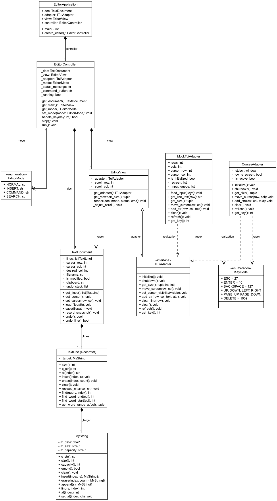

# MyVim — Консольный текстовый редактор

**MyVim** — это легковесный терминальный текстовый редактор с VIM-подобной системой модального управления, разработанный на Python 3.

Проект демонстрирует практическое применение паттернов проектирования (**MVC**, **Adapter**, **Decorator**), работу с C++ библиотеками через Python C-Extensions (`pybind11`), а также независимое тестирование TUI-компонентов.

---

## Внешний вид и демонстрация работы

Редактор воспроизводит классический интерфейс VIM: рабочую область текста с символами `~` для пустых строк, информационную статус-строку с текущим режимом и координатами курсора, а также нижнюю командную строку.


---

## Архитектура и паттерны проектирования

Архитектура системы строго разделена на независимые слои в соответствии с принципами SOLID:



### 1. Архитектурный паттерн MVC (Model-View-Controller)
* **Model (`TextDocument`)**: инкапсулирует состояние текстового файла, список строк `TextLine`, позицию курсора с запоминанием целевой колонки (`desired_col`), буфер обмена, стек снимков состояния для многоуровневой отмены (`undo` / `undo_line`) и поисковый механизм.
* **View (`EditorView`)**: отвечает за расчёт области видимости (скроллинг экрана), форматирование строк и отрисовку статус-бара. Не содержит бизнес-логики и взаимодействует с экраном только через абстракцию `ITuiAdapter`.
* **Controller (`EditorController`)**: реализует конечный автомат (FSM) режимов работы (`NORMAL`, `INSERT`, `COMMAND`, `SEARCH`). Принимает события ввода от адаптера, буферизует многосимвольные команды (`dd`, `yy`, `gg`, `10G`), парсит команды командной строки и координирует модель и представление.

### 2. Паттерн Адаптер (Adapter)
Для изоляции кода от низкоуровневой терминальной библиотеки `curses` выделен абстрактный контракт `ITuiAdapter`:
* **`CursesAdapter`**: конкретная реализация поверх `curses` для работы в реальном терминале macOS/Linux. Обеспечивает корректное восстановление состояния экрана при выходе и защиту от задержки клавиши ESC (`set_escdelay(25)`).
* **`MockTuiAdapter`**: реализация виртуального экрана и очереди ввода в памяти. Позволяет запускать тесты интерфейса в headless-режиме (в CI/CD) без реального TTY.

### 3. Паттерн Декоратор (Decorator)
* **`TextLine`**: класс-декоратор, оборачивающий C++ класс `MyString` (динамическая библиотека `MyString_wrapper` на `pybind11`). Декоратор делегирует операции хранения и модификации символов C++ объекту, дополняя его алгоритмами VIM-навигации по границам слов (`find_word_start`, `find_word_end`, `get_word_range_at`).

---

## Поддерживаемые команды и режимы

### 1. Режим навигации и базового редактирования (NORMAL)
Режим по умолчанию при запуске.

| Клавиша | Действие |
| :--- | :--- |
| `h`, `j`, `k`, `l` (или стрелки) | Перемещение курсора влево, вниз, вверх, вправо |
| `0`, `^`, `Home` | Переход в начало текущей строки |
| `$`, `End` | Переход в конец текущей строки |
| `w` | Переход к концу текущего или следующего слова |
| `b` | Переход к началу текущего или предыдущего слова |
| `gg` | Переход в начало документа (строка 1) |
| `G` | Переход в конец документа |
| `<число>G` (например `10G`) | Переход на указанную строку документа |
| `PageUp` / `PageDown` | Постраничная прокрутка текста |
| `x` / `Delete` | Удаление символа под курсором с сохранением в буфер |
| `r<символ>` | Замена символа под курсором на введённый |
| `dd` | Вырезание текущей строки в буфер обмена |
| `yy` | Копирование текущей строки в буфер обмена |
| `yw` | Копирование слова под курсором в буфер обмена |
| `diw` | Удаление слова под курсором в буфер обмена |
| `p` | Вставка содержимого буфера обмена после курсора / строки |
| `u` | Отмена последнего изменения (Undo) |
| `U` | Отмена всех изменений в текущей строке |
| `n` / `N` | Повтор поиска вперёд / назад |
| `q` | Быстрый выход из редактора (если файл не был изменён) |
| `ESC` (дважды) | Быстрый выход из редактора |
| `Ctrl+C` / `Ctrl+D` | Аварийное корректное завершение программы |

### 2. Переход в режим ввода (INSERT)

| Клавиша | Описание |
| :--- | :--- |
| `i` | Вставка перед курсором |
| `I` | Вставка в начале строки |
| `A` | Вставка в конце строки |
| `o` | Открытие новой строки снизу и переход в режим ввода |
| `O` | Открытие новой строки сверху и переход в режим ввода |
| `S` | Очистка текущей строки и начало ввода |
| `ESC` | Выход из режима ввода обратно в режим NORMAL |

### 3. Режим командной строки (COMMAND)
Активируется нажатием `:` в режиме NORMAL. Поддерживаются русские алиасы при случайном наборе без переключения раскладки.

| Команда | Русские алиасы | Действие |
| :--- | :--- | :--- |
| `:w` | `:ц` | Сохранить изменения в текущий файл |
| `:w <filename>` | `:ц <filename>` | Сохранить документ под указанным именем |
| `:o <filename>` | `:щ <filename>` | Открыть файл с диска |
| `:q` | `:й` | Выйти из программы (с проверкой на несохранённые правки) |
| `:q!` | `:й!` | Принудительный выход без сохранения |
| `:wq` / `:x` | `:цй` / `:ч` | Сохранить документ и выйти |
| `:e!` | — | Откатить все изменения к сохранённой версии файла |
| `:<число>` | — | Переход на указанную строку документа |
| `:h` | — | Вывод подсказки по основным командам в статус-строку |
| `ESC` | — | Отмена ввода команды и возврат в NORMAL |

### 4. Режим поиска (SEARCH)
* `/<запрос>` + `Enter`: циклический поиск подстроки от курсора вперёд до конца файла.
* `?<запрос>` + `Enter`: циклический поиск подстроки от курсора назад к началу файла.
* `ESC`: отмена поиска.

---

## Системные требования и запуск

* **Операционная система**: macOS (Darwin) или Linux.
* **Интерпретатор**: Python 3.10+ (протестировано на Python 3.11).
* **Библиотеки**: стандартная библиотека Python (`curses`), сторонние пакеты для работы редактора не требуются.

### Запуск редактора:

```bash
# 1. Запуск пустого редактора
python3 main.py

# 2. Открытие существующего файла (или создание нового с указанным именем)
python3 main.py test.txt
```

---

## Тестирование

Для проверки корректности работы всех компонентов реализован тестовый набор на базе фреймворка `pytest`:
* Тестирование адаптеров TUI (`tests/test_adapter.py`).
* Тестирование связки MVC и декоратора строки (`tests/test_mvc_skeleton.py`).
* Комплексное тестирование всех операций модели документа (`tests/test_model_full.py`).
* Тестирование FSM-контроллера, горячих клавиш и командного режима (`tests/test_controller_full.py`).

Запуск тестов:

```bash
python3 -m pytest tests/ -v
```

